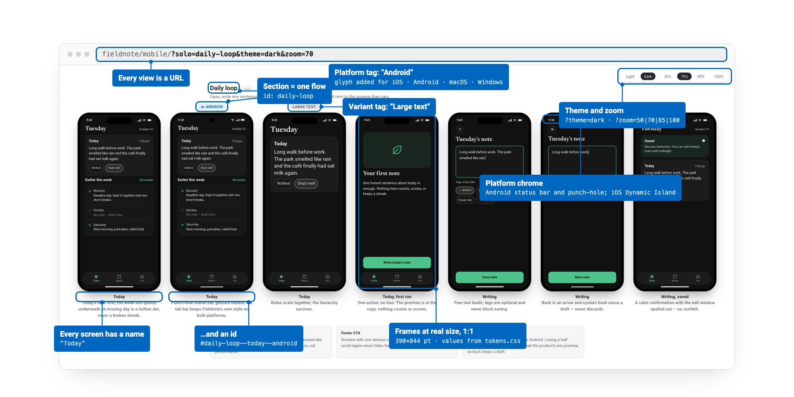
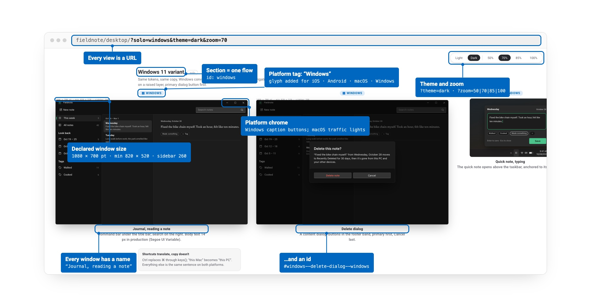
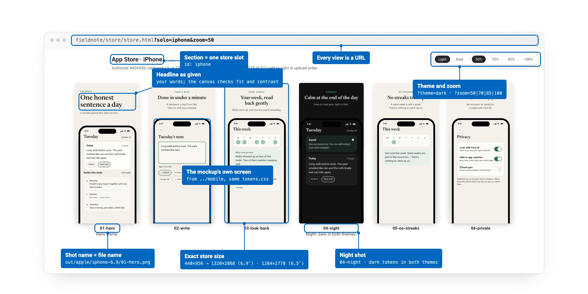
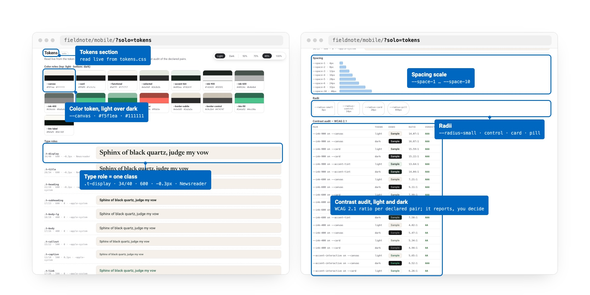

# Mockup Skills

**A canvas for app mockups in plain HTML: a family of
[Agent Skills](https://agentskills.io) for Claude Code, Codex, Cursor,
Qwen Code, and any agent that reads `SKILL.md`.**

These skills don't design your app. What goes inside a screen (layout, copy,
colors, which states exist) is yours. The skills own everything around the
screens:

- **Grouping**: pages are product areas, sections are flows, columns are
  screen states, read left to right.
- **Naming**: every screen has a name (`Today, empty`) and an id
  (`daily-loop--today-empty`) that links, captures and tickets refer to.
- **Tags**: `iOS`, `Android`, `macOS`, `Windows`, or a variant (`Plus`),
  above the frame.
- **Frames**: phone and desktop windows at production size, 1:1, with each
  platform's chrome.
- **Tokens**: one `tokens.css` with your values, wired so a change reaches
  every screen, rendered live as a tokens section with a contrast audit.
- **Capture**: every section and screen at a deterministic URL
  (`?solo=daily-loop&theme=dark&zoom=100`), so screenshots are reproducible.

<p align="center">
  
</p>

| Skill | Lays out | Frame |
| --- | --- | --- |
| [`mobile-mockups`](skills/mobile-mockups/SKILL.md) | iOS and Android screens and flows | phone, 390×844 |
| [`desktop-mockups`](skills/desktop-mockups/SKILL.md) | macOS and Windows windows, menu-bar panels, sheets, settings | window, at its declared size |
| [`store-screenshots`](skills/store-screenshots/SKILL.md) | mockup screens on App Store, Google Play and Mac App Store canvases | store canvases, exported at exact sizes |

All three share one canvas engine and read the same `tokens.css`, so a
product's phone mockup, desktop mockup and store shots use the same values.

### mobile-mockups

Phone frames at 390×844 for iOS and Android. Each section is a flow; each
column is one screen with a name and an id; Android and variant columns
carry a tag with the platform's glyph.

<p align="center">
  
</p>

### desktop-mockups

macOS and Windows windows at their declared size, with each platform's
chrome (traffic lights or caption buttons), menu-bar and tray panels,
sheets and dialogs, on the same tokens as the phone app.

<p align="center">
  
</p>

### store-screenshots

The mockup's own screens placed on App Store, Google Play and Mac App Store
canvases. Headlines are yours; shots are named by upload order
(`01-hero`, `02-write`, …), and the name is the file name.

`export.sh` turns the gallery into upload-ready files with headless Chrome:

- each shot is captured at its authoring size times an integer scale
  (440×956 × 3 = 1320×2868), never by resizing the window, so headlines wrap
  exactly as they do in the gallery;
- the capture is then resampled to every size the store asks for: iPhone
  6.9″ 1320×2868 and 6.5″ 1284×2778, Play phone 1080×1920, Mac 2880×1800
  and 1280×800, in-app purchase images 1024×1024, the Play feature graphic
  1024×500, and optionally the Play icon at 512×512 from your own icon;
- files land in `out/<store>/<slot>/NN-name.png`, and the script reads back
  and prints every file's real pixel size so a wrong size shows up before
  upload;
- it resamples with `sips` on macOS or ImageMagick elsewhere (ImageMagick
  also strips transparency, which the stores reject).

<p align="center">
  
</p>

### Tokens, shared by all three

`tokens.css` holds the product's values. The tokens section reads it live:
every color token as a light-over-dark swatch, every `.t-*` type role with
its metrics, the spacing and radius scales, and a WCAG 2.1 contrast audit
of the color pairs the screens use, in both themes. The audit reports; the
values stay your call.

<p align="center">
  
</p>

The images are rendered from the live examples by
[`examples/cards/render.sh`](examples/cards/render.sh).

## Quick start

One command, works with any supported agent
([70+ of them](https://github.com/vercel-labs/skills)):

```bash
npx skills add euzharkov/mockup-skills
```

Then ask:

> mock up the onboarding flow for my app

The matching skill asks where your tokens come from and which platforms you
ship, scaffolds the canvas into your repo, and lays out the screens you
describe.

<details>
<summary><strong>Claude Code plugin marketplace</strong></summary>

This repo is also a Claude Code plugin marketplace. Inside Claude Code:

```
/plugin marketplace add euzharkov/mockup-skills
```

then install the `mockups` plugin from the `/plugin` menu. It contains all
three skills.

</details>

<details>
<summary><strong>Manual install</strong></summary>

Each skill is a folder under [`skills/`](skills/). Copy the ones you want
into your agent's skills directory:

| Agent       | Per project                    | Personal (all projects)       |
| ----------- | ------------------------------ | ----------------------------- |
| Claude Code | `.claude/skills/<skill>/`      | `~/.claude/skills/<skill>/`   |
| Codex CLI   | `.codex/skills/<skill>/`       | `~/.codex/skills/<skill>/`    |
| Cursor      | `.cursor/skills/<skill>/`      | —                             |
| Qwen Code   | `.qwen/skills/<skill>/`        | `~/.qwen/skills/<skill>/`     |

Every skill folder is self-contained. Codex and Qwen Code load skills at
startup, so restart the agent after installing.

</details>

<details>
<summary><strong>Upgrading</strong></summary>

This repo was `mobile-mockups-skill`, then briefly `app-design-skills`.

- Existing mockup directories keep working. The engine still reads
  `design-system.css` and `?solo=foundations`; new directories use
  `tokens.css`, `MOCKUP.md` and `?solo=tokens`. The skills leave old names
  alone unless you ask to upgrade.
- Columns can now take a `name`, which gives each screen an id. Old
  `label: "<b>Name.</b> …"` columns render as before.
- The `app-icon` skill is gone: an icon is a design asset, not a mockup.
- Remove `mobile-mockups-skill` or the `app-design` plugin before
  installing, so two copies don't answer the same request.

</details>

## How it works

A mockup directory is static files:

```
mockup/
├── tokens.css          your values, in the structure the canvas reads
├── MOCKUP.md           the contract: platforms, pages, naming, token table
├── mockup-core.css/js  the canvas engine
├── phone.* / window.*  the frame
├── index.html          tokens section + first area
└── <area>.html         one page per further area
```

Each page declares its sections and columns as data and calls
`renderMockupPage()`:

```js
renderMockupPage({
  title: "Settings",
  sections: [{
    id: "delete-account",
    title: "Delete account",
    cols: [
      { name: "Account", html: phone(account) },
      { name: "Delete, confirm", html: phone(confirm) },
      { name: "Delete, confirm", tag: "Android", tagAccent: true,
        html: phone(confirmAndroid, { platform: "android" }) },
    ],
  }],
});
```

The canvas renders the page head, section index, rails of frames, names,
tags and notes, plus a toolbar for light/dark and zoom. All of it is driven
by the URL:

| URL | Shows |
| --- | --- |
| `?solo=tokens` | the tokens section and contrast audit |
| `?solo=<section-id>` | one section, for fast loads and reliable captures |
| `?theme=dark` | dark tokens in every frame |
| `?zoom=100` | frames at production size |
| `#<section-id>--<screen>` | one screen |

There is deliberately no component library: screen markup is presentation,
so production is never pushed to mirror a mockup's components. What moves
to production is tokens by name, type roles by name, and screen ids as the
names of states.

### Why HTML

- Agents read, write and diff HTML fluently: no plugin API, no export step.
- It's versionable: mockup changes are PRs, mockup history is git history.
- The tokens section reads the real CSS, so it can't drift from it.
- No build step: a directory of static files and any static server.

## Examples

One fictional product, **Fieldnote** (a private journal, one sentence a
day), on every surface:

- **[Mobile](https://euzharkov.github.io/mockup-skills/examples/fieldnote/mobile/)**
  — sections for the daily loop (with its Android and large-text twins),
  the weekly look-back, privacy, and edge cases, with named screens and
  platform tags.
- **[Desktop](https://euzharkov.github.io/mockup-skills/examples/fieldnote/desktop/)**
  — the Mac menu-bar quick note, the journal window, sheets, settings, and
  Windows columns, on the same tokens.
- **[Store screenshots](https://euzharkov.github.io/mockup-skills/examples/fieldnote/store/store.html)**
  — iPhone, Android and Mac App Store shots built from the mockup screens,
  with the script that exports them at exact store sizes.

Older studies built with the original mobile skill:
[iOS Calendar](https://euzharkov.github.io/blog/mobile-mockups-skill-examples/ios-calendar/)
and [Gmail iOS](https://euzharkov.github.io/blog/mobile-mockups-skill-examples/gmail/).
The story of that skill is in the article
**[I Built a Mobile App Mockup Skill](https://open.substack.com/pub/euzharkov/p/i-built-a-mobile-app-mockup-skill)**.

To run the Fieldnote examples locally, serve the repo root:

```bash
python3 -m http.server 4680
```

then open `http://localhost:4680/examples/fieldnote/mobile/`.

## Repository layout

```
mockup-skills/
├── skills/
│   ├── mobile-mockups/      # SKILL.md, assets/ (starter canvas), references/
│   ├── desktop-mockups/
│   └── store-screenshots/
├── shared/                  # the one place shared files are edited
│   ├── assets/              # mockup-core.*, phone.*, window.*
│   └── references/          # canvas.md, tokens.md, review.md, handoff.md
├── examples/fieldnote/      # one fictional product across all three skills
└── scripts/sync.sh          # copies shared/ into each skill and example
```

Skills install one folder at a time, so each one carries its own copy of the
shared files. Edit them in `shared/` and run `scripts/sync.sh`; CI runs
`scripts/sync.sh --check` and fails if a copy has drifted.

## License

MIT
