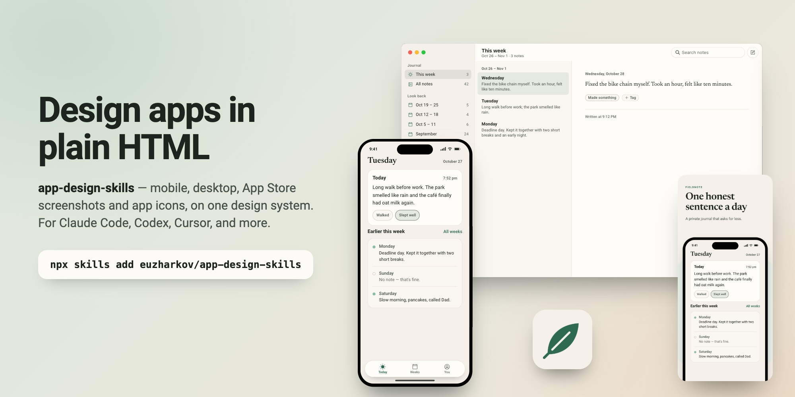

# App Design Skills

**Design your app in plain HTML instead of Figma — a family of
[Agent Skills](https://agentskills.io) for Claude Code, Codex, Cursor,
Qwen Code, and any agent that reads `SKILL.md`.**

Ask your agent to *"mock up the onboarding flow"*, *"design the settings
window for the Mac app"*, *"make our App Store screenshots"*, or *"explore
some app icon directions"*. The right skill picks it up, interviews you,
builds a small design system for your product, and produces pages you review
as screenshots in a real browser: real copy, light and dark themes, and a
live accessibility audit included.

<p align="center">
  
</p>

| Skill | For | Frame |
| --- | --- | --- |
| [`mobile-mockups`](skills/mobile-mockups/SKILL.md) | iOS and Android app screens, flows, design systems | phone, 390×844 |
| [`desktop-mockups`](skills/desktop-mockups/SKILL.md) | macOS and Windows apps: windows, menu-bar panels, sheets, settings | window, at its real size |
| [`store-screenshots`](skills/store-screenshots/SKILL.md) | App Store, Google Play and Mac App Store graphics, plus listing text | store canvases, exported to exact sizes |
| [`app-icon`](skills/app-icon/SKILL.md) | Icon concepts, iOS/Android/macOS variants, export at every size | icon grids and home-screen context |

All four share one engine and one rule: **a product has one palette.** The
store screenshots reuse the mockup's screens and colors; the desktop app
reuses the phone app's color roles; the icon is drawn from the same roles.
Change a role once and every surface follows.

Extracted from real production work, where whole apps were designed this
way before a line of them was implemented. The story of the original mobile
skill — why HTML beats Figma when your designer is an agent — is in the
article:
**[I Built a Mobile App Mockup Skill](https://open.substack.com/pub/euzharkov/p/i-built-a-mobile-app-mockup-skill)**.

## Quick start

Install all four ([70+ supported agents](https://github.com/vercel-labs/skills)):

```bash
npx skills add euzharkov/app-design-skills
```

or only the ones you need:

```bash
npx skills add euzharkov/app-design-skills --skill mobile-mockups --skill store-screenshots
```

Then just ask for design work:

> mock up the onboarding flow for my app

The matching skill triggers on its own, interviews you about your product,
and builds from there.

<details>
<summary><strong>Claude Code plugin marketplace</strong></summary>

This repo is also a Claude Code plugin marketplace. Inside Claude Code:

```
/plugin marketplace add euzharkov/app-design-skills
```

then install the `app-design` plugin from the `/plugin` menu. It contains
all four skills.

</details>

<details>
<summary><strong>Manual install</strong></summary>

Each skill is a folder under [`skills/`](skills/). Copy the ones you want
into your agent's skills directory:

| Agent       | Per project                    | Personal (all projects)       |
| ----------- | ------------------------------ | ----------------------------- |
| Claude Code | `.claude/skills/<skill>/`      | `~/.claude/skills/<skill>/`   |
| Codex CLI   | `.codex/skills/<skill>/`       | `~/.codex/skills/<skill>/`    |
| Cursor      | `.cursor/skills/<skill>/`      | —                             |
| Qwen Code   | `.qwen/skills/<skill>/`        | `~/.qwen/skills/<skill>/`     |

Every skill folder is self-contained. Codex and Qwen Code load skills at
startup, so restart the agent after installing.

</details>

<details>
<summary><strong>Upgrading from mobile-mockups-skill</strong></summary>

This repo used to be a single skill called `mobile-mockups-skill`. It is now
`skills/mobile-mockups/`, with the same method and the same files, except
that the engine is split into `mockup-core.*` (shared) and `phone.*` (the
frame). Existing mockup directories keep working as they are; the skill
recognizes the old `mockup.js` layout and leaves it alone unless you ask to
upgrade. Remove the old `mobile-mockups-skill` folder from your skills
directory and install `mobile-mockups` to avoid two skills answering the
same request.

</details>

## Examples

One fictional product, **Fieldnote** — a private journal, one honest
sentence a day — designed across every surface:

- **[Mobile](https://euzharkov.github.io/app-design-skills/examples/fieldnote/mobile/)**
  — the daily loop, weekly look-back, privacy and deletion, errors and edge
  content, the largest text size, and the Android differences.
- **[Desktop](https://euzharkov.github.io/app-design-skills/examples/fieldnote/desktop/)**
  — the Mac menu-bar quick note, the main journal window, sheets, settings,
  and a Windows variant, all on the same palette.
- **[Store screenshots](https://euzharkov.github.io/app-design-skills/examples/fieldnote/store/store.html)**
  — iPhone, Android and Mac App Store shots, subscription squares and the
  Play feature graphic, with the export script that renders them to exact
  store sizes.
- **[App icon](https://euzharkov.github.io/app-design-skills/examples/fieldnote/icon/icon.html)**
  — concept round, the chosen direction, and every platform variant.

Fidelity studies of real apps, built with the mobile skill:

- **[iOS Calendar study](https://euzharkov.github.io/blog/mobile-mockups-skill-examples/ios-calendar/)**
  — day/year/month/list views and the iOS 26 "New" sheet, with Apple's own
  sub-AA contrast choices flagged (not hidden) by the audit.
- **[Gmail iOS study](https://euzharkov.github.io/blog/mobile-mockups-skill-examples/gmail/)**
  — inbox rows, the drawer, a thread, compose with a simulated keyboard, and
  the account sheet, with all mail data replaced by fictional equivalents.

<p align="center">
  
  
</p>

To run the examples locally, start any static server at the repo root:

```bash
python3 -m http.server 4680
```

then open `http://localhost:4680/examples/fieldnote/mobile/`.

## Why HTML instead of Figma?

When your designer is an agent, a design tool is the wrong medium. Static
HTML is the right one:

- **Agents are native here.** They read, write, and diff HTML/CSS fluently —
  no plugin API, no export step, no screenshots-of-canvases.
- **It's versionable.** Design reviews become PRs. Design history becomes
  git history.
- **The style guide can't lie.** The auto-generated foundations page renders
  palette, type ramp, spacing, and radii live from the actual CSS, plus a
  WCAG contrast audit for both themes. Drift is impossible.
- **Copy is real.** Screens carry shippable words, so the mockup doubles as
  the copy spec. Production takes text from it 1:1.
- **Handoff is honest.** Design values map to your production theme 1:1 by
  role name, and sizes in the mockup are the sizes you ship. No redlines, no
  eyedropper.
- **No build step.** A directory of static files and any static server.

## How it works

Every skill follows the same two layers, nothing else:

1. **A design system** — `design-system.css`: flat semantic values (color
   roles, type roles, spacing, radii, one dark override block) plus
   `DESIGN-SYSTEM.md`, the written contract that keeps agents honest across
   sessions.
2. **Pages** — one HTML page per flow area; sections are flows, frames are
   states.

There is deliberately **no component library** in between — mockup classes
are presentation hooks, so your production app is never pressured to mirror
a fake component API.

The mockup skills interview you, scaffold the starter canvas into your repo,
build the design system until the contrast audit is green, build screens
with a states discipline (empty, loading, error, edge — not just the happy
path), review their own work as light and dark screenshots, and hand off
values by role into your production theme. The store and icon skills start
from that design system and end in exported files.

### The workbench

`mockup-core.js` + `mockup-core.css` render the gallery around your frames;
`phone.*` and `window.*` draw the devices:

- frames authored 1:1 with production units (390×844 pt for phones; desktop
  windows at their real size)
- light/dark toggle and zoom, all URL-driven (`?theme=dark&zoom=70`), so
  every screenshot is reproducible
- **solo mode** (`?solo=section-id`): one section only, for fast loads and
  reliable captures on long pages
- auto-generated foundations section + WCAG 2.1 contrast audit, read live
  from your `design-system.css`

## Repository layout

```
app-design-skills/
├── skills/
│   ├── mobile-mockups/      # SKILL.md, assets/ (starter canvas), references/
│   ├── desktop-mockups/
│   ├── store-screenshots/
│   └── app-icon/
├── shared/                  # the one place shared files are edited
│   ├── assets/              # mockup-core.*, phone.*, window.*
│   └── references/          # design-system.md, review.md, handoff.md
├── examples/fieldnote/      # one fictional product across all four skills
└── scripts/sync.sh          # copies shared/ into each skill and example
```

Skills install one folder at a time, so each one carries its own copy of the
shared files. Edit them in `shared/` and run `scripts/sync.sh`; CI runs
`scripts/sync.sh --check` and fails if a copy has drifted.

## License

MIT
